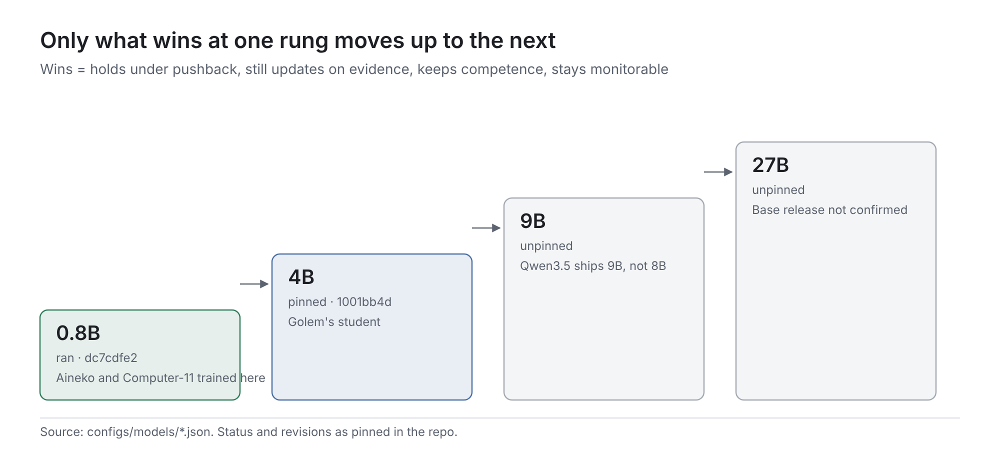

# The pipeline, stage by stage

This is the engineering manual: the full quickstart, every stage, the design rules and the scale ladder. The [README](../README.md) covers why this exists and where it stands.

## Quickstart

```bash
git clone https://github.com/Nalehs/Character-Training && cd Character-Training
pip install -e ".[train]"                        # pipeline + training (torch, transformers, peft, trl 1.14.1)
pip install -e environments/character_pushback   # the verifiers evaluation environment

character-pipeline new moth --name MOTH          # scaffold characters/moth from the template
$EDITOR characters/moth/BIBLE.md characters/moth/JUDGE_RULES.md characters/moth/scenarios.jsonl

scripts/serve_teacher.sh &                       # Qwen3-30B-A3B on llama.cpp, :8080
D1_API_KEY=$(openssl rand -hex 24) scripts/serve_d1.sh &   # d1-2B judge on CPU, :8090

character-pipeline run characters/moth --model qwen3.5-0.8b-base
#   generates, checks and judges teacher chats, then stops: a person must review them
character-pipeline review-sheet characters/moth  # write runs/moth/review.todo.jsonl; mark each turn accept/reject
mv runs/moth/review.todo.jsonl runs/moth/review.jsonl
character-pipeline run characters/moth --model qwen3.5-0.8b-base
#   resumes: shared SFT -> student samples -> pairs -> DPO, KTO, continued SFT -> serve each arm
#   -> pushback eval, three seeds each, plus the prompted baseline
character-pipeline status                        # every character: steps done, next step, hold/drift/cave per arm
```

Run another recipe on the same character with `--recipe recipes/oct-2025.json`, and change scale with `--model qwen3.5-4b-base`. `character-pipeline run … --dry-run` prints every command without running anything.

**No GPU? Check it works first.** Each of these runs the real code on a tiny random model built locally, with stand-in servers. They test the plumbing, not any character.

| Command | What it exercises |
| --- | --- |
| `python -m unittest discover -s tests` | unit tests, standard library only (3 expected failures document the checker's known bugs) |
| `python scripts/pipeline_smoke.py` | the orchestrator end to end: reviewed chats → 5 evaluated arms → ecology |
| `python scripts/oct_pipeline_smoke.py` | the Open Character Training recipe end to end through the orchestrator |
| `python scripts/train_smoke.py`, `python scripts/oct_smoke.py` | the training stages one by one |
| `environments/character_pushback/smoke/run_smoke.sh` (and `run_smoke_extended.sh`) | the pushback environment through `vf-eval`, including every opt-in eval |

## Stages

Every stage is a module with a CLI, reads and writes JSONL under `runs/<character>/`, and is also exposed as `character-pipeline <stage>`. `character-pipeline run` chains them. A finished step is skipped, so any run can be resumed. The run stops at the two places where a person is needed, and writes its fully resolved settings to `runs/<character>/resolved_recipe.json`.

| # | Stage | Command | Module | Ported from |
| --- | --- | --- | --- | --- |
| 1 | Character folder | `new` | `characters/_template` | Zero's bible format (core, style, association graph) |
| 2 | Teacher chats | `generate` | `generate/teacher.py`, `controller.py` | golem-15 G6 kernel |
| 3 | Fabrication and repetition checks | `check` | `check/` | golem-15 G6 checker (**the blocker**) |
| 4 | Per-turn judge, shadow only | `judge` | `judge/d1.py` | decision-models d1-2B pilot |
| 5 | Human review, clean chats, family split | `review-sheet`, `clean` | `run.review_sheet`, `data/clean.py` | new |
| 6 | Shared SFT (3 seeds) | `sft` | `train/sft.py`, `train/common.py` | Aineko run 1 loop; R0 4B loading and masking |
| 7a | Student samples → pairs | `sample`, `pairs` | `train/sample.py`, `data/pairs.py` | Aineko OCT (rejected = the student's own reply) |
| 7b | DPO · KTO · continued SFT from the same SFT | `dpo`, `kto`, `sft --init-adapter` | `train/preference.py`, `train/sft.py` | Aineko TRL 1.14.1 code |
| 8 | Serve and evaluate every arm | `serve`, `eval` | `serve.py`, `evaluate.py` → `character-pushback` | new |
| 9 | Activation controls | library | `activation/` | persona-vectors, neurons |
| — | Many characters | `status`, `ecology` | `ecology.py` | new |

## Design rules

- Raw generations are never edited.
- Neither the checker nor the judge filters data on its own until it is calibrated on human labels.
- Every arm branches from one shared SFT checkpoint, with that checkpoint frozen as its reference, so differences between arms come from the objective alone.
- KTO labels are never derived from DPO pairs.
- Over-long rows are dropped and logged, never truncated.
- A model preset without a pinned revision refuses to train.

The full write-up of our own recipe is [recipes/character-pipeline-v0.md](recipes/character-pipeline-v0.md).

## The scale ladder



`character-pipeline models` lists the presets in [configs/models](../configs/models). Only what wins at one rung moves up to the next. "Wins" means it holds character under pushback without losing the ability to update on evidence, or losing competence or monitorability.

| Rung | Preset | Revision | Hardware | Status |
| --- | --- | --- | --- | --- |
| 0.8B | `qwen3.5-0.8b-base` | `dc7cdfe2` | CPU is enough | run (Aineko, Computer-11) |
| 4B | `qwen3.5-4b-base` | `1001bb4d` | one 16 GB T4, fp16 LoRA (R0) | pinned; Golem's student |
| 9B (the "8B" rung) | `qwen3.5-9b-base` | unpinned | not measured | Qwen3.5 ships 9B, not 8B |
| 27B | `qwen3.5-27b` | unpinned | not measured | a Base release is not confirmed; if none exists, this rung starts from instruct, like OCT |
| other families | — | — | — | planned, for diversity of the substrate |

Each preset also names its post-trained sibling, for the `prompted_instruct` control: Zero's headline comparison, as opposed to our Base-plus-prompt control. That control runs once its revision is pinned.
